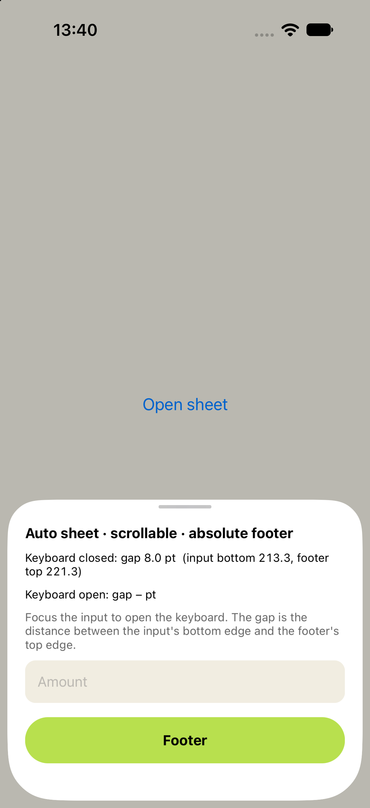
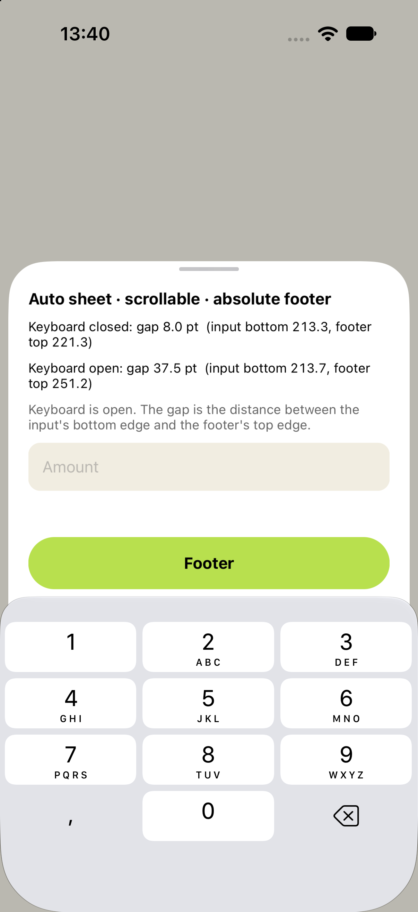
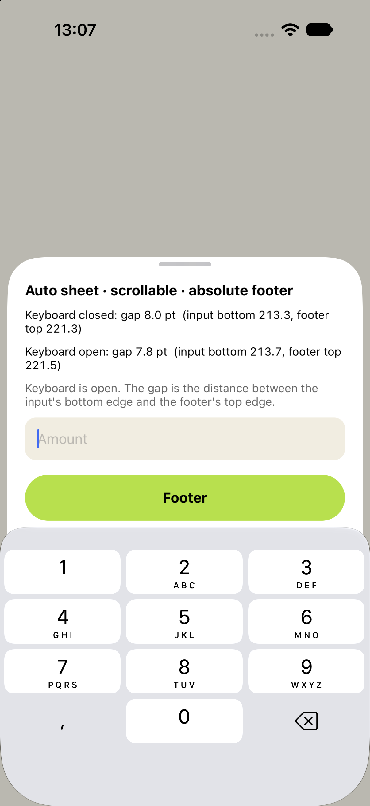
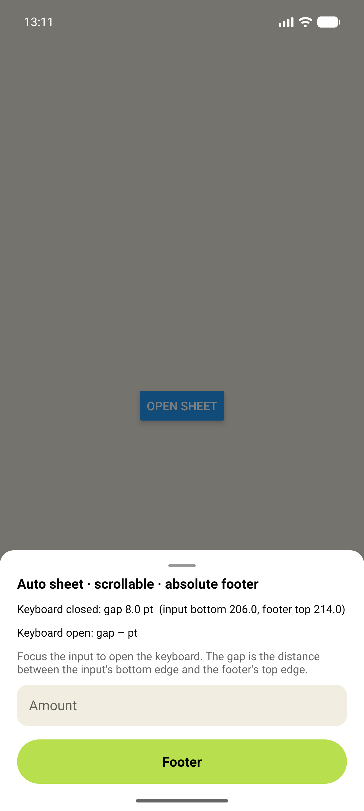
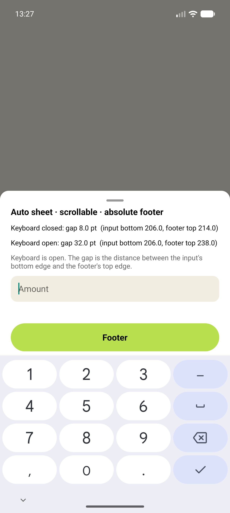
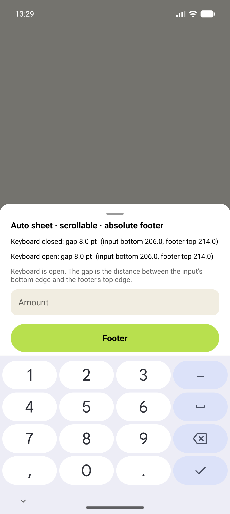

# TrueSheet: gap between content and footer while the keyboard is open

Minimal reproduction for `@lodev09/react-native-true-sheet` 4.1.2 on iOS and Android.

An `auto` sheet with a scrollable and an absolute footer keeps the bottom safe-area inset in its height while the keyboard is open, although the footer no longer shows that inset above the keyboard (iOS drops it from the footer's height, Android tucks it behind the keyboard's top edge). The distance between the end of the content and the top of the footer grows by roughly the inset.

## Setup

| | |
| - | - |
| `@lodev09/react-native-true-sheet` | 4.1.2, unpatched |
| `react-native` | 0.88.1 (new architecture, Hermes) |
| `expo` | SDK 58 |
| iOS | iPhone 18 Pro simulator, iOS 27.2, software keyboard (decimal pad) |
| Android | Pixel 10 Pro emulator, API 37, Gboard (number pad), edge-to-edge |

One screen, [`App.tsx`](App.tsx): a button presents a sheet with `detents={['auto']}`, a `ScrollView` passed as `scrollableRef`, a footer with `footerOptions={{ position: 'absolute' }}` and a `TextInput` as the last element of the scroll content.

## Run

```sh
npm install
npx expo run:ios      # or: npx expo run:android
```

1. Tap **Open sheet**.
2. Tap the input so the keyboard opens.

The sheet measures itself: it shows the distance between the input's bottom edge and the footer's top edge with the keyboard closed and open (`measureInWindow` on both, 700 ms after the keyboard settles).

## Result

Gap between the input and the footer:

| | iOS, keyboard closed | iOS, keyboard open | Android, keyboard closed | Android, keyboard open |
| - | - | - | - | - |
| 4.1.2 | 8.0 pt | 37.5 pt | 8.0 dp | 32.0 dp |
| 4.1.2 with [`fix-keyboard-gap.diff`](fix-keyboard-gap.diff) | 8.0 pt | 7.8 pt | 8.0 dp | 8.0 dp |

iOS:

| Keyboard closed | Keyboard open, 4.1.2 | Keyboard open, with the diff |
| - | - | - |
|  |  |  |

Android:

| Keyboard closed | Keyboard open, 4.1.2 | Keyboard open, with the diff |
| - | - | - |
|  |  |  |

## The change

[`fix-keyboard-gap.diff`](fix-keyboard-gap.diff) is not applied by default. To try it:

```sh
patch -p1 -d node_modules/@lodev09/react-native-true-sheet < fix-keyboard-gap.diff
npx expo run:ios
```

It takes the part of the bottom safe area that ends up above the keyboard out of the auto detent, for an absolute footer that avoids the keyboard.

- iOS (`TrueSheetViewController.mm`): the value is measured from the sheet's own geometry, so it also covers the floating sheet layout on iOS 26+.
- Android (`TrueSheetDetentCalculator.kt`): the footer's absorbed inset, capped at the keyboard height. `footerOptions.keyboardOffset` is not taken into account.
